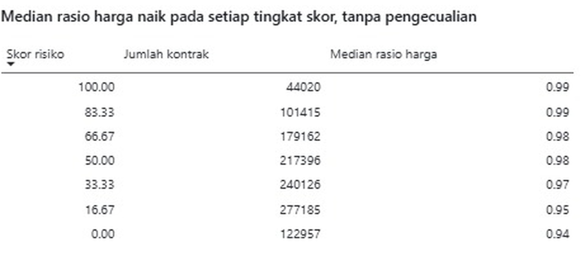
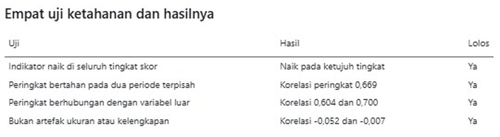
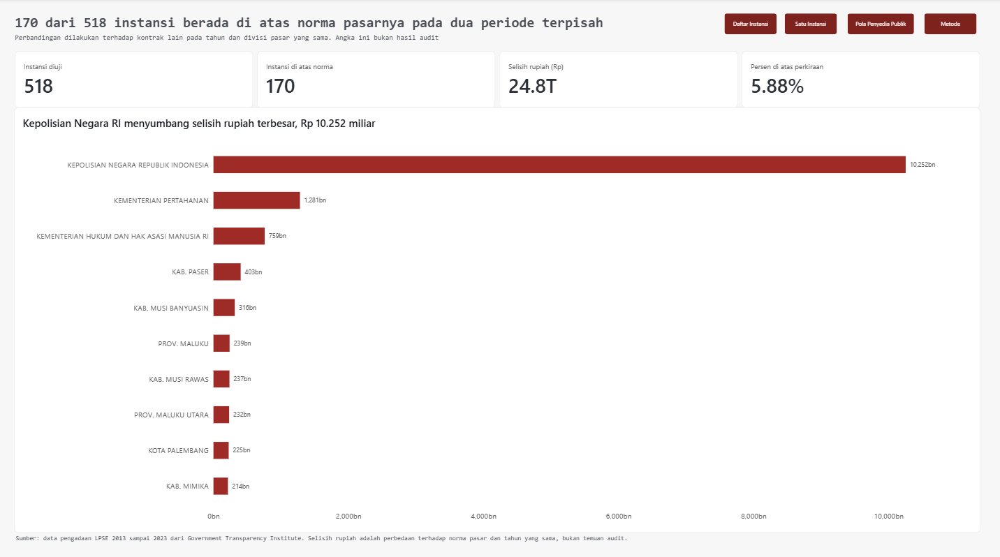
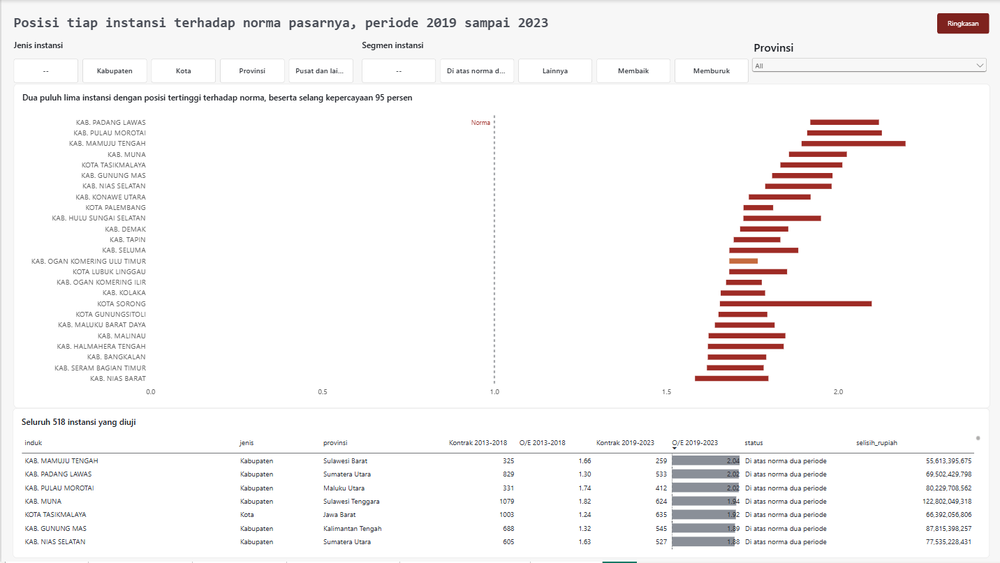
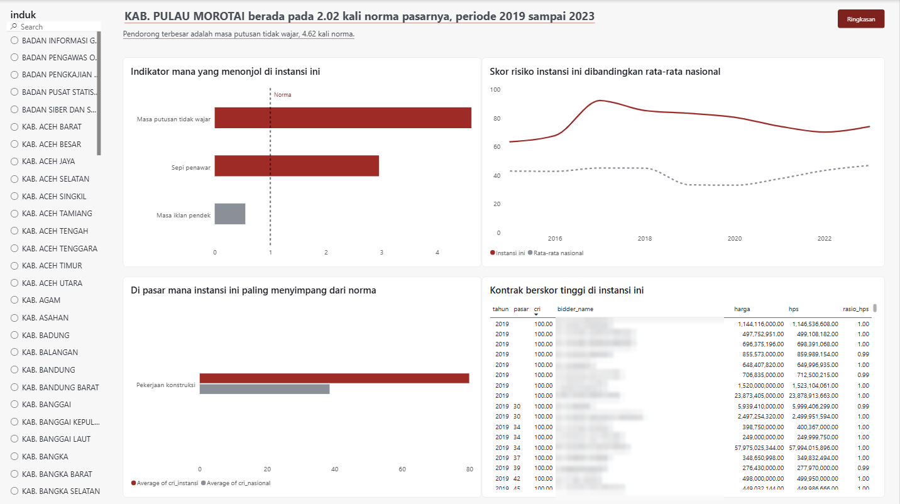
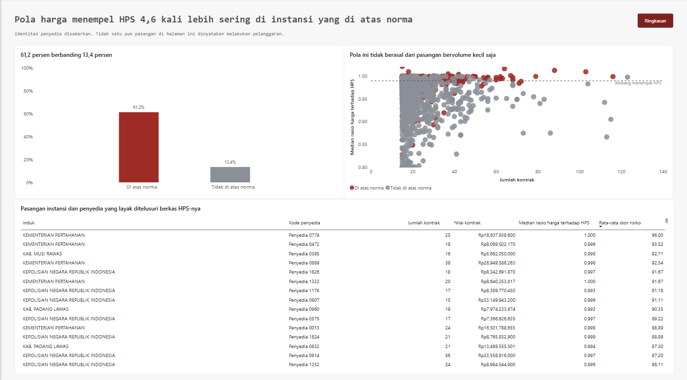
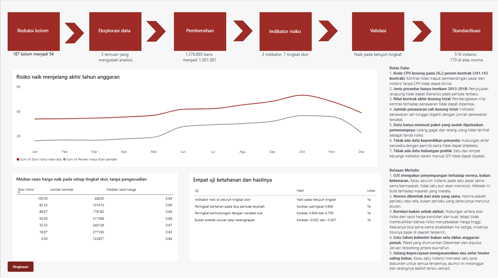

# Analisis Risiko Pengadaan Pemerintah Indonesia (2013 sampai 2023)

**Menemukan instansi mana yang layak diperiksa lebih dulu, tanpa menghukum instansi hanya karena jenis belanjanya.**

Fatwa Ferdiansyah · Final Project, Data Analyst Bootcamp Dibimbing.id
[Portofolio](https://fatwaferdiansyah97-dev.github.io/data-analyst-portfolio/) · [LinkedIn](https://www.linkedin.com/in/fatwa-ferdiansyah-9951ba278) · [GitHub](https://github.com/fatwaferdiansyah97-dev)

> **Catatan penting.** Daftar instansi di proyek ini adalah **urutan prioritas pemeriksaan**, bukan hasil audit. Proyek ini tidak menyimpulkan bahwa instansi mana pun melakukan pelanggaran, dan selisih rupiah di dalamnya **bukan angka kerugian negara**.

---

## Masalah bisnis

Pemeriksa pengadaan jumlahnya terbatas, sedangkan instansinya ribuan. Pemeriksaan harus diurutkan menurut risiko.

Masalahnya, mengurutkan skor risiko mentah begitu saja menyesatkan. Skor mentah ikut mengukur **apa yang dibeli**, bukan hanya **bagaimana membelinya**. Instansi yang banyak membangun jalan akan selalu terlihat lebih berisiko daripada instansi yang banyak membeli jasa konsultansi, karena pasar konstruksi di mana pun skornya tinggi.

**Pertanyaan bisnis:** instansi mana yang skor risikonya lebih tinggi daripada yang seharusnya, setelah jenis belanja dan tahunnya diperhitungkan?

---

## Data

- **Sumber:** Government Transparency Institute, dihimpun dari publikasi tender LPSE ([tautan unduhan](https://www.govtransparency.eu/public-procurement-datasets-underpinning-the-project-on-corruption-risks-and-natural-disasters/)).
- **Berkas mentah:** `ID_data_202402_gti.csv`, 10,79 GB, 187 kolom, 5.453.095 baris. Satu baris adalah satu penawaran.
- **Setelah reduksi dan pembersihan:** 1.301.381 kontrak bersih, dan 957.460 kontrak yang bisa dibandingkan antar instansi.

Berkas mentah dan berkas hasil reduksi tidak diunggah karena ukurannya. Skrip `python/01_reduksi.py` mengubah berkas mentah menjadi tiga berkas kerja, dan notebook berjalan dari ketiga berkas itu.

---

## Lima masalah data yang ditemukan sebelum analisis

| No | Masalah | Tindakan |
|---|---|---|
| 1 | Kolom jumlah penawar (`lot_bidscount`) ternyata berisi jumlah **pendaftar**, bermedian 21 | Indikator "sepi penawar" disusun ulang dari hitungan baris penawaran per paket |
| 2 | Indikator resmi `INTEGRITY_SINGLE_BID` dibangun dari kolom yang sama | Tidak dipakai, diganti hitungan sendiri |
| 3 | Porsi penunjukan langsung turun dari 57% ke 0,3% pada 2019 | Perubahan pencatatan, bukan reformasi. Analisis dipecah menjadi dua periode |
| 4 | Kode jenis barang (CPV) punya tiga panjang karena nol di depan hilang | Diperbaiki; 123.403 kode pindah kelompok |
| 5 | Rasio harga terhadap HPS ada yang di bawah 0,01 dan di atas 2 | Batas 0,10 sampai 1,20 untuk analisis harga; 7.691 kontrak **ditandai, tidak dihapus** |

---

## Metode

**Skor risiko** dari tiga indikator dengan bobot sama: sepi penawar, masa iklan pendek, dan masa putusan tidak wajar. Indikator yang datanya tidak layak (konsentrasi pembeli, jenis prosedur, penawaran sah tunggal) sengaja dibuang.

**Standardisasi tidak langsung (Observed / Expected):**

1. Seluruh kontrak dibagi ke sel tahun dikali divisi pasar.
2. Untuk tiap sel, dihitung rata-rata skor kontrak **instansi lain**, supaya instansi tidak menilai dirinya sendiri.
3. Harapan skor sebuah instansi disusun dari campuran belanjanya sendiri.
4. O/E = skor yang terjadi dibagi skor yang diharapkan. Di atas 1 berarti lebih berisiko daripada norma pasarnya.
5. Selang kepercayaan 95%, dengan galat baku dikelompokkan per tender.

**Pengecekan dari luar:** rasio harga terhadap HPS tidak dipakai menyusun skor, tetapi median rasionya naik di ketujuh tingkat skor tanpa pengecualian (0,943 ke 0,990).



---

## Temuan utama

- **170 dari 518 instansi** berada di atas norma pasarnya pada **dua periode terpisah** (2013 sampai 2018 dan 2019 sampai 2023), yang memakai kumpulan kontrak berbeda.
- Hasilnya bertahan pada **lima uji ketahanan**. Mengganti sel pembanding menghasilkan 162 sampai 173 instansi. Menambahkan bulan ke sel pembanding menghasilkan korelasi O/E 0,987.
- 170 instansi itu membayar **5,88% di atas perkiraan**, sedangkan instansi lain 1,82% di bawah perkiraan.
- **61,2%** pasangan instansi dan penyedia di kelompok ini punya median harga yang menempel HPS (0,99 ke atas), dibanding **13,4%** di instansi lain.
- Masalah terpusat di tingkat kabupaten: **37%** kabupaten yang diuji berada di atas norma, dibanding 6% provinsi.
- Risiko naik menjelang akhir tahun anggaran: skor rata-rata naik dari 33,8 (Januari) ke 53,2 (Oktober), dan puncaknya jatuh di Oktober atau November pada 11 dari 11 tahun.



---

## Rekomendasi

1. Periksa 170 instansi, mulai dari kabupaten dan paket konstruksi.
2. Periksa berkas penetapan HPS pada pasangan penyedia yang harganya menempel HPS.
3. Dahulukan 28 instansi yang memburuk (O/E naik dari 0,82 ke 1,17), karena penurunan yang baru terjadi lebih mudah dikoreksi.
4. Sesuaikan permintaan keterangan dengan indikator pendorong tiap instansi.
5. Beri pengawasan tambahan pada paket yang diumumkan September sampai November.
6. Pelajari 52 instansi yang membaik, lalu jalankan ulang skor setiap tahun.

---

## Dasbor Power BI (5 halaman)

| Halaman | Pertanyaan yang dijawab |
|---|---|
| 1. Ringkasan | Berapa instansi menyimpang dan berapa rupiahnya |
| 2. Daftar Instansi | Siapa saja, beserta selang kepercayaannya |
| 3. Satu Instansi | Indikator dan pasar mana yang menyimpang |
| 4. Pola Penyedia | Pasangan penyedia mana yang layak ditelusuri |
| 5. Metode | Seberapa bisa dipercaya, dan apa batasnya |







File `.pbix` tidak diunggah karena melebihi batas ukuran file GitHub (100 MB).

---

## Batas analisis

**Boleh disimpulkan:**
- Skor risiko berhubungan dengan hasil ekonomi yang secara teori memang diharapkan.
- Peringkat instansi bertahan pada dua kumpulan kontrak yang berbeda.
- Daftar 170 instansi layak dipakai sebagai urutan prioritas pemeriksaan.

**Tidak boleh disimpulkan:**
- Bahwa instansi dalam daftar ini melakukan pelanggaran. Ini bukan hasil audit.
- Bahwa selisih harga adalah kerugian negara.
- Bahwa skor risiko menyebabkan harga tinggi. Keduanya bisa disebabkan hal ketiga, misalnya pasar yang tipis di daerah terpencil.

**Batas terbesar:** O/E mengukur penyimpangan terhadap norma, bukan terhadap kebenaran. Kalau seluruh instansi di satu pasar sama-sama bermasalah, tidak satu pun akan menonjol.

---

## Tools

`Python (Pandas, Google Colab)` `PostgreSQL (DBeaver)` `Power BI`

## Struktur repositori

```
├── README.md
├── SUMBER_DATA.txt
├── python/
│   └── 01_reduksi.py
├── notebook/
│   └── Analisa_Risiko_Pengadaan_Pemerintah_Indonesia.ipynb
├── slides/
│   └── Presentasi_Portofolio_Final_Project.pdf
└── assets/
    └── (screenshot dasbor dan grafik)
```
